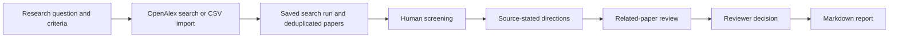

# Research Evidence Explorer

Research Evidence Explorer is a local workspace for turning a literature search into a reviewable set of research directions. It keeps the search record, paper screening decisions, source passages, and reviewer notes together so a proposed direction can be traced back to the evidence.

**Current release:** V1 supports article abstracts, one local reviewer, OpenAlex search or CSV import, and Markdown export. Candidate directions require human assessment. The app does not establish that a topic is novel or absent from the wider literature.

## Why it exists

Early literature reviews often end up spread across browser tabs, spreadsheets, and notes. That makes it hard to answer basic questions: Which query found a paper? Why was it included? Where did a proposed research direction come from? Research Evidence Explorer records those decisions and links each candidate to an exact sentence in an included abstract.

## What V1 does

- **Reproducible search record:** Save OpenAlex title-and-abstract queries, publication-year filters, run dates, result counts, and failures. Import a CSV when you already have a corpus.
- **Paper screening:** Mark papers as included, excluded, or unsure. Exclusions require a reason. Repeated imports link to existing DOI records.
- **Traceable directions:** Detect explicit limitation and future-work sentences in included abstracts and preserve their source and character offset.
- **Evidence review:** Surface other included abstracts with related wording for inspection. A reviewer records a counterevidence check and a written assessment before accepting a direction.
- **Export:** Download a Markdown report with the search history, screening totals, exclusions, accepted directions, source records, and reviewer notes.

## Workflow



The search and screening record defines the scope of each report. A low number of matching abstracts is not evidence that a topic is unstudied.

## Run locally

Use Python 3.10 or newer. From the repository root on Windows:

```powershell
python -m venv .venv
.\.venv\Scripts\python.exe -m pip install -r requirements-v1.txt
.\.venv\Scripts\python.exe -m streamlit run research_app.py --server.address 127.0.0.1
```

Open the local URL printed by Streamlit. V1 has no account system, so keep it bound to `127.0.0.1`.

The app stores review data in `data/research_evidence.sqlite3`, which Git ignores. Set `REE_DB_PATH` to use another database path. Set `OPENALEX_API_KEY` if your OpenAlex access requires a key; the app does not write it into search history.

### Try the offline sample

1. Create a project with a focused research question and inclusion/exclusion criteria.
2. Click **Import bundled AI-in-education sample** in the Search tab.
3. Screen relevant papers in **Screen papers**.
4. Click **Find directions in included papers** in **Investigate directions**.
5. Inspect the source sentence and related abstracts, record your assessment, then export the report.

The bundled 24-abstract sample is a demonstration corpus selected by topic. It is not a comprehensive search.

### Import your own data

Provide a UTF-8 CSV with `title` and `abstract` columns. Optional columns include `authors`, `year`, `doi`, and `url`. For live discovery, enter an OpenAlex query and year range in the Search tab. V1 searches article titles and abstracts and caps each run at 500 returned records.

## Project structure

| Path | Purpose |
| --- | --- |
| `research_app.py` | Streamlit review interface and report export |
| `rag_gap_finder/discovery.py` | OpenAlex search and CSV parsing |
| `rag_gap_finder/workspace.py` | SQLite schema, search records, screening, and review decisions |
| `rag_gap_finder/evidence.py` | Source sentence detection and related-paper retrieval |
| `tests/test_workspace_v1.py` | V1 workflow and search tests |
| `data/ai_education_papers.csv` | Offline sample abstracts |

The earlier text-analysis exploration remains available in `app.py` and [its archived guide](docs/legacy-course-demo.md). The V1 workflow runs through `research_app.py`.

## Verify

```powershell
.\.venv\Scripts\python.exe -m pytest -q tests/test_workspace_v1.py
```

The V1 tests cover search pagination with a mocked API response, CSV validation, persistent screening and review decisions, DOI deduplication, exact source offsets, and the acceptance gate. The complete repository test suite also covers the earlier text-analysis code.

## Current limits and next steps

V1 works from abstracts. It can miss relevant papers and may extract a sentence that does not represent a useful research gap. Related-paper similarity provides reading leads; it does not determine whether a paper supports or contradicts a claim. A reviewer must inspect the wider literature before treating a direction as novel.

Next steps are full-text passage extraction, stronger paper identity and version handling, a labeled evaluation set for retrieval and citation support, multi-reviewer decisions, and versioned report snapshots. These will be added only after the V1 review workflow is evaluated with real users.
